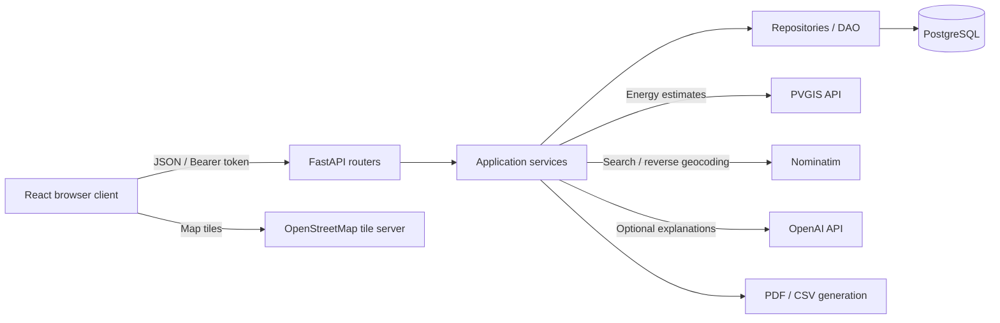

# SolarPlan


SolarPlan is a full-stack application for preliminary residential solar-system planning. It connects roof dimensions and module specifications with location-based energy estimates, helping homeowners and students explore how a proposed photovoltaic system could perform before commissioning a detailed engineering design.

A project can contain several roof surfaces with different directions and slopes. SolarPlan generates panel layouts, estimates production through PVGIS, compares production with household consumption, and preserves saved simulations for later comparison and reporting. Its focus is technical and energy analysis; it does not calculate pricing, financial returns, or installation quotations.

Developed as a final-year Bachelor's thesis project in Information Technologies at International Burch University.

## Contents

- [Key Features](#key-features)
- [Technology Stack](#technology-stack)
- [System Architecture](#system-architecture)
- [How SolarPlan Works](#how-solarplan-works)
- [Solar Energy Estimation](#solar-energy-estimation)
- [Solar Panel Layout](#solar-panel-layout)
- [Project Structure](#project-structure)
- [Getting Started](#getting-started)
- [API Documentation](#api-documentation)
- [Testing](#testing)
- [Screenshots](#screenshots)
- [Limitations](#limitations)
- [Future Improvements](#future-improvements)
- [Academic Context](#academic-context)
- [Author](#author)

## Key Features

### Project planning

- Registration, login, authenticated sessions, and owner-scoped private projects.
- Workspace dashboard, project creation/editing, and project configuration status.
- Map-based location selection with address search and reverse geocoding.
- Multiple rectangular or trapezoidal roof surfaces, including saved asymmetric trapezoids.
- Compass-direction and slope selection, with support for existing custom numeric values.
- Source-linked module catalog containing dimensions, rated power, efficiency, and technology.

### Layout and configuration comparison

- Polygon-aware panel placement with portrait/landscape orientation, edge margins, and panel gaps.
- Layout preview, capacity calculation, selectable panel count, and saved module specifications.
- One shared panel model across the project's saved roof layouts.
- Separate Configuration Optimizer for evaluating saved/manual and automatic configurations, including production and consumption-oriented criteria.
- Candidate review and explicit application; existing simulation history is retained.

### Energy analysis and reporting

- PVGIS estimates for each roof surface, aggregated into annual and monthly project production.
- Installed capacity, specific yield, and production contribution by roof surface.
- Adjustable system-loss assumption, with the saved value recorded in each simulation.
- Annual or monthly household consumption and production/consumption comparison.
- Saved simulation history, comparison of two simulations, and configuration freshness tracking.
- PDF and CSV reports generated from saved simulation snapshots.
- Optional, user-triggered AI explanations of saved results and comparisons.

### Administration

- Separate administrator dashboard with database-backed aggregate statistics.
- Panel catalog management, activation/deactivation, and protected deletion.
- User search, pagination, and account activation/deactivation.
- Private projects remain owner-scoped; administrator status does not grant access to another user's project data.

## Technology Stack

| Layer | Technology | Role |
| --- | --- | --- |
| Interface | React, TypeScript, Vite | Component-based client and production asset build |
| Routing and server state | React Router, TanStack Query | Protected routes, navigation, data fetching and cache invalidation |
| Maps | Leaflet, React Leaflet, OpenStreetMap tiles | Interactive property location selection |
| API | Python, FastAPI, Pydantic | HTTP endpoints, request validation and response schemas |
| Persistence | SQLAlchemy async, asyncpg, PostgreSQL | Relational storage and asynchronous database access |
| Migrations | Alembic | Versioned schema changes and initial catalog data |
| Authentication | PyJWT, pwdlib with Argon2 | Signed access tokens and password hashing |
| External HTTP | httpx | PVGIS, Nominatim and optional OpenAI adapters |
| Reports | ReportLab, Python CSV utilities | On-demand PDF and CSV generation |
| Testing | Pytest, pytest-asyncio, Vitest, Testing Library | Backend, integration and React behavior tests |
| Development and deployment | Docker Compose, Ruff, Caddy | Local stack, Python checks and prepared HTTPS deployment configuration |

## System Architecture



### Backend responsibilities

The backend follows a **Router → Service → Repository/DAO** structure. Routers validate HTTP requests and translate application errors; services implement planning and analysis rules; repositories own database queries. Pydantic schemas define the API boundary, while SQLAlchemy models define persistence.

The external integrations sit behind adapters. The layout engine is deterministic Python code and does not require an external geometry or AI service.

### Data model

| Entity | Main relationship and purpose |
| --- | --- |
| User | Owns multiple projects; stores role, account activity and password hash |
| Project | Groups location, roofs, layouts, consumption and analysis history |
| ProjectLocation | One optional location per project |
| RoofSurface | Multiple surfaces per project; geometry, tilt, azimuth and spacing |
| PanelLayout | Saved surface layout linked to a catalog panel, with a panel-specification snapshot |
| SolarPanel | Shared catalog records used for new layouts and optimizer candidates |
| ElectricityConsumptionProfile | Optional project household profile with annual/monthly consumption |
| EnergySimulation | Saved input snapshot and aggregate/per-surface production results |
| ConfigurationOptimization | Stored candidate evaluation for a project |
| PvgisCacheEntry | Normalized provider response keyed by calculation inputs and method/provider versions |

A legacy `RoofConfiguration` model/API is also retained alongside the multi-surface workflow. Project-owned records use foreign-key relationships and deletion cascades. Saved simulations are not overwritten by recalculation, but deleting their parent project deletes its associated records.

### Authentication and access control

Passwords are hashed with Argon2. The API issues expiring HS256 JWT access tokens and checks their signature, issuer, audience, token type and expiration. Protected requests load the current user from the database, so deactivated accounts cannot continue using an existing token.

The frontend stores its access token in `sessionStorage` and sends it as a Bearer token. Backend ownership checks enforce access to private resources; frontend route guards are an additional navigation layer. Registration always creates an active `USER`; assigning `ADMIN` requires a trusted CLI operation. See [Administration](docs/ADMIN.md).

## How SolarPlan Works

1. **Create an account and project.** Give the project a name and optional description.
2. **Set the location.** Search for the property or select its position on the map.
3. **Describe the roof.** Add one or more surfaces using actual dimensions along the roof plane, direction and slope.
4. **Choose a module and save layouts.** Review portrait/landscape placement and panel count. Saved surfaces must use the same project panel model.
5. **Run Production Analysis.** SolarPlan requests or reuses a PVGIS estimate for each surface and saves the combined result.
6. **Add consumption if available.** Compare annual totals and, when supplied, individual months.
7. **Explore alternatives.** Use Configuration Optimizer to evaluate alternatives and explicitly apply a candidate.
8. **Review history and export.** Compare two saved simulations, download PDF/CSV reports, or request an optional AI explanation.

The workspace and project overview distinguish projects that are not started, in progress, analyzed, or require recalculation. Configuration fingerprints compare relevant inputs with a saved simulation; descriptive edits are excluded from the current fingerprint. Older snapshots use a conservative fallback when full input data is unavailable.

## Solar Energy Estimation

SolarPlan's PVGIS adapter calls the configured versioned `PVcalc` endpoint. The default provider configuration is PVGIS 5.3. The public PVGIS integration does not require an application API key.

### Calculation inputs

| Input | Source / handling |
| --- | --- |
| Latitude and longitude | Saved project location |
| Peak power, kWp | Saved panel count × module rated power / 1,000 |
| Tilt | Saved roof-surface slope |
| Aspect | Compass azimuth converted to PVGIS's south-zero convention |
| System losses | User-selected assumption; default 14% |
| Technology and mounting | Adapter defaults: `crystSi` and `free` |

SolarPlan uses north-zero clockwise compass azimuth: north 0°, east 90°, south 180°, west 270°. The adapter converts these to PVGIS aspect: south 0°, east −90°, west 90°.

Each surface receives an estimate based on its own installed capacity, tilt and direction. The backend validates the provider response, normalizes its twelve monthly values, and sums roof results into project totals. Specific yield expresses annual production per installed kWp.

Results are cached in PostgreSQL using a deterministic key covering provider/method versions and request parameters. The HTTP adapter has configurable timeouts and bounded retries for transient failures. A simulation stores the calculation inputs, panel metadata, losses and results, allowing history and exports to remain tied to the configuration that produced them.

These are typical-year estimates, not live generation measurements or forecasts. Roof dimensions affect how many modules fit; the provider calculation uses resulting capacity rather than a detailed three-dimensional model of the roof or surroundings.

### Consumption comparison and AI

Annual coverage and balance compare production with recorded consumption. Monthly comparison uses known monthly consumption values; missing months are not invented. These totals do not establish hourly self-consumption or grid independence.

AI explanations are optional and start only after an explicit user action. The backend sends allowlisted system/energy evidence; names, coordinates, addresses and private resource IDs are excluded. Including current consumption is optional. Structured output and numerical references are validated, but qualitative explanation remains an interpretation of the saved results. AI does not change calculations, layouts or simulations and is not included in PDF/CSV exports.

## Solar Panel Layout

The layout engine works in metres in the two-dimensional roof plane:

1. Construct the rectangle or trapezoid from bottom width, top width, length and top offset.
2. Inset the convex polygon by the configured perpendicular edge margin.
3. Convert module dimensions from millimetres to metres and apply portrait or landscape orientation.
4. Step through rows using module length plus panel gap. For each row, use the available width at both its top and bottom so panels remain inside the usable polygon.
5. Place whole panels using module width plus gap. Return positions, maximum count, occupied area and utilization.
6. Use the full available count or a requested count within capacity.

```text
installed capacity (kWp) = panel count × module rated power (Wp) / 1,000
```

This is a deterministic row-based packing algorithm, not a proof of globally optimal packing over arbitrary polygons or mixed orientations. The Configuration Optimizer evaluates combinations using the existing layout and energy calculations; it is distinct from placement within one surface.

New roof forms currently default to a **0.5 m edge margin** and **0.02 m panel gap**. These are planning assumptions, not universal safety or installation standards. Existing saved spacing values are preserved. Geometry/spacing edits can invalidate a saved layout; name-only changes preserve it. Saved panel snapshots protect existing configurations from subsequent catalog edits.

## Project Structure

```text
SolarPlan/
├── backend/
│   ├── app/
│   │   ├── core/             Configuration, security and application errors
│   │   ├── dependencies/     Authentication, role and session dependencies
│   │   ├── db/               SQLAlchemy base and async session setup
│   │   ├── models/           Relational models
│   │   ├── schemas/          Pydantic request/response contracts
│   │   ├── repositories/     Database access (DAO layer)
│   │   ├── services/         Layout, simulations, optimizer and business rules
│   │   ├── integrations/     PVGIS and OpenAI adapters
│   │   ├── routers/          HTTP endpoints
│   │   └── main.py           FastAPI application factory
│   ├── alembic/              Schema and catalog migrations
│   ├── tests/                Backend unit and integration tests
│   └── pyproject.toml         Python dependencies and tool configuration
├── frontend/
│   ├── src/
│   │   ├── auth/             Session context
│   │   ├── components/       Shared interface components
│   │   ├── pages/            Planning, analysis and administration screens
│   │   ├── lib/              API client and shared helpers
│   │   └── types/            TypeScript API types
│   └── package.json          Frontend dependencies and scripts
├── docs/                     QA, administration and deployment documentation
├── deploy/                   Prepared production and backup/restore tooling
├── .env.example              Development environment template
├── docker-compose.yml        Development services
└── compose.production.yaml   Separate production deployment configuration
```

## Getting Started

### Prerequisites

- Git.
- Docker Engine with Compose v2, or Docker Desktop with its Linux engine running, for the recommended local setup.
- For manual development: Python **3.12+**, Node.js **24** (matching the frontend Docker image), npm, and PostgreSQL. The Compose database uses PostgreSQL **17**.
- Internet access for initial dependency/image downloads, map tiles, geocoding and uncached PVGIS calculations. An OpenAI key is needed only for AI explanations.

### Clone the repository

```bash
git clone https://github.com/przuljp/SolarPlan.git
cd SolarPlan
```

### Option A: Docker Compose

From the repository root, create the local configuration:

```bash
# macOS / Linux
cp .env.example .env
```

```powershell
# Windows PowerShell
Copy-Item .env.example .env
```

Review `.env` before starting. Its database hostname `db` addresses the PostgreSQL service inside Compose; the API and frontend port settings must agree with CORS and `VITE_API_URL`. The template's development credentials must not be used for production. Keep `.env` out of version control.

```bash
docker compose up -d --build
```

The backend runs `alembic upgrade head` before Uvicorn, applying schema changes and migration-managed catalog records. No manual database reset or seed command is required.

| Service | Local address |
| --- | --- |
| Frontend | http://localhost:5173 |
| API health | http://localhost:8000/api/v1/health |
| Swagger UI | http://localhost:8000/docs |
| ReDoc | http://localhost:8000/redoc |
| PostgreSQL | `localhost:5432` |

```bash
docker compose logs -f backend
docker compose down
```

Stopping with `down` preserves the database volume. Adding `-v` deletes the development database volume and its data. If Docker reports that `dockerDesktopLinuxEngine` cannot be found, start Docker Desktop and wait for the Linux engine before retrying.

### Option B: Manual backend and frontend

#### 1. PostgreSQL configuration

Using a PostgreSQL administrator account, create an application role and database. The role command prompts for a password:

```bash
createuser -U postgres --pwprompt solarplan
createdb -U postgres --owner=solarplan solarplan
```

If these already exist, use the existing local role/database instead. Adapt the administrator account to your PostgreSQL installation.

#### 2. Backend setup and environment

From the repository root:

```bash
cd backend
python -m venv .venv
```

Activate the virtual environment using your shell:

```bash
# macOS / Linux
source .venv/bin/activate
cp ../.env.example .env
```

```powershell
# Windows PowerShell
.\.venv\Scripts\Activate.ps1
Copy-Item ../.env.example .env
```

Edit **`backend/.env`** before running migrations. Set `SOLARPLAN_DATABASE_URL` to your local role/password/database and use `localhost` instead of Compose's `db` hostname. The driver prefix must be `postgresql+asyncpg://`; URL-encode reserved characters in credentials. Set a private `SOLARPLAN_JWT_SECRET` and keep `SOLARPLAN_ENVIRONMENT=development` for local work.

```bash
python -m pip install -e ".[dev]"
alembic upgrade head
uvicorn app.main:app --reload
```

Run these commands from `backend/`, where the Alembic configuration and backend `.env` are located. The API starts at port 8000.

#### 3. Frontend setup

In a second terminal, from the repository root:

```bash
cd frontend
npm ci
npm run dev
```

The default API address is `http://localhost:8000/api/v1`. To override it, add `VITE_API_URL` to `frontend/.env`; `VITE_MAP_TILE_URL` can override the map tile URL. Restart the dev server after environment changes. A root `.env` is not automatically read by manually started frontend/backend processes in their subdirectories.

### Configuration reference

See [.env.example](.env.example) for the complete development template and [backend settings](backend/app/core/config.py) for validation/defaults.

| Variable | Purpose |
| --- | --- |
| `POSTGRES_DB`, `POSTGRES_USER`, `POSTGRES_PASSWORD` | Compose database initialization |
| `POSTGRES_PORT`, `BACKEND_PORT`, `FRONTEND_PORT` | Development host ports |
| `SOLARPLAN_DATABASE_URL` | SQLAlchemy async PostgreSQL connection URL |
| `SOLARPLAN_JWT_SECRET` | Backend token-signing secret |
| `SOLARPLAN_ACCESS_TOKEN_EXPIRE_MINUTES` | Access-token lifetime; default 30 minutes |
| `SOLARPLAN_CORS_ORIGINS` | JSON list of permitted frontend origins |
| `SOLARPLAN_GEOCODING_*` | Nominatim endpoint, application identity, timeout, request spacing and cache settings |
| `SOLARPLAN_PVGIS_*` | PVGIS endpoint/version, timeout, retries and default loss assumption |
| `SOLARPLAN_OPENAI_API_KEY` | Optional backend-only AI credential; empty disables explanations |
| `SOLARPLAN_OPENAI_MODEL` | Configured explanation model; current default `gpt-5-mini` |
| `SOLARPLAN_OPENAI_TIMEOUT_SECONDS`, `SOLARPLAN_OPENAI_MAX_OUTPUT_TOKENS` | AI request limits |
| `VITE_API_URL`, `VITE_MAP_TILE_URL` | Public frontend API and map endpoints |

Never put credentials in `VITE_*` variables: Vite embeds them in browser assets. For Compose AI setup, update the root `.env` and run `docker compose up -d --force-recreate backend`. Without a key, the planning and analysis workflow remains available.

### Administration and production

There is no default administrator account or shipped administrator password. Register an account first, then follow the controlled promotion procedure in [Administration](docs/ADMIN.md).

The development Compose stack exposes ports and runs development servers. A separate production configuration, Caddy HTTPS setup, secret validation, and encrypted backup/restore tooling are documented in [Deployment](docs/DEPLOYMENT.md) and [Production Readiness](docs/PRODUCTION_READINESS.md). These files prepare deployment; they do not imply that a public deployment, off-site backup destination or monitoring service is already active. They are not a Heroku-specific deployment recipe.

## API Documentation

All application routes use the `/api/v1` prefix. In development, interactive documentation is available at [Swagger UI](http://localhost:8000/docs) and [ReDoc](http://localhost:8000/redoc), with the schema at `http://localhost:8000/openapi.json`. Production settings disable these documentation endpoints.

| Group | Representative routes under `/api/v1` |
| --- | --- |
| Authentication and identity | `/auth/register`, `/auth/login`, `/users/me` |
| Workspace and projects | `/projects`, `/projects/workspace`, `/projects/{project_id}` |
| Location and geocoding | `/projects/{project_id}/location`, `/geocoding/search`, `/geocoding/reverse` |
| Roofs | `/projects/{project_id}/roof-surfaces`; legacy `/projects/{project_id}/roof` |
| Catalog and layout | `/panels`, `/projects/{project_id}/roof-surfaces/{surface_id}/layout`, layout `/preview` |
| Production and history | `/projects/{project_id}/simulations`, `/latest`, `/compare`, `/{simulation_id}` beneath that collection |
| Consumption | `/projects/{project_id}/consumption`, `/projects/{project_id}/energy-comparison` |
| Optimization | `/projects/{project_id}/optimize`, `/projects/{project_id}/optimizations/latest` and candidate application |
| Reports | `/projects/{project_id}/simulations/{simulation_id}/report?format=pdf` or `format=csv` |
| AI | `/ai/status`, `/projects/{project_id}/simulations/{simulation_id}/explanation` and comparison explanations |
| Administration | `/admin/dashboard`, `/admin/users`, `/admin/panels` |

Use the generated schema for methods, request bodies, validation and exact subroutes. Authenticated calls require `Authorization: Bearer <access_token>`; admin endpoints additionally require the current administrator role.

Reports are generated on demand from saved snapshots without another PVGIS call or stored report files. CSV uses UTF-8 with a BOM and neutralizes formulas in user-supplied text. Reports do not include the current consumption profile or AI explanation.

## Testing

Run backend checks from `backend/` with the development dependencies installed:

```bash
pytest -q
ruff check app tests
ruff format --check app tests
```

Run frontend checks from `frontend/`:

```bash
npm test
npm run build
```

The build runs TypeScript project checking before producing the Vite bundle. Frontend tests cover forms, protected navigation, layout controls, analysis, optimizer, history, reports, AI states and administration. Backend tests cover schemas, authorization, ownership, geometry, provider normalization/retries, simulations, consumption, optimization, reports and AI evidence validation. External-provider behavior is mocked in automated tests; these checks are not a guarantee of live provider availability.

For Compose-based development:

```bash
docker compose exec backend pytest -q
docker compose exec frontend npm test
docker compose exec frontend npm run build
```

### PostgreSQL integration tests

Some administration and migration tests are skipped unless `SOLARPLAN_TEST_DATABASE_URL` is set. Use a **disposable, isolated PostgreSQL server** with an asyncpg URL and a role permitted to create/drop test databases. These tests create temporary databases and exercise migrations, authorization and concurrent administration behavior. Do not point them at production.

Set the variable in the same environment that executes Pytest, then run:

```bash
pytest -q tests/test_admin.py tests/test_admin_migration.py
```

For historical manual verification and its scope, see [Clean Database QA](docs/CLEAN_DATABASE_QA.md) and [User Flow QA](docs/USER_FLOW_QA.md). Test counts in those reports describe their recorded revision, not a permanent coverage or test-count claim.

## Screenshots

Screenshots have not yet been added to this repository. This section is reserved for real application captures:

- Workspace dashboard and Project Overview.
- Roof geometry and panel-layout preview.
- Production Analysis and household consumption comparison.
- Configuration Optimizer and simulation-history comparison.

No placeholder image paths or generated mockups are included.

## Limitations

- **Preliminary engineering scope:** no structural assessment, electrical string design, inverter sizing, permitting checks or certification of mounting clearances.
- **Simplified roof geometry:** rectangle/trapezoid roof planes and row-based placement; no arbitrary roof obstacles, satellite polygon extraction or LiDAR reconstruction.
- **Shading:** nearby trees, buildings, chimneys and detailed roof self-shading are not modeled. Provider estimates do not replace a site-specific shading study.
- **Energy assumptions:** fixed technology/mounting parameters and an aggregate loss percentage simplify real installations. Weather and operating conditions can differ from typical-year estimates.
- **Consumption resolution:** annual/monthly energy balances do not model hourly matching, battery dispatch, export restrictions or grid independence.
- **Optimization scope:** candidate search is bounded by implemented catalog, layout and ranking rules; it is not a universal global optimum or a financial recommendation.
- **External availability:** uncached estimates, geocoding, tiles and optional AI depend on third-party services and their limits.
- **AI interpretation:** explanations can be unavailable or rejected; numerical evidence validation does not guarantee every qualitative statement. Process-local explanation caching/rate controls do not provide distributed protection across replicas.
- **Deployment:** the repository includes deployment preparation, but host/domain configuration, provider constraints, monitoring and off-site backup activation still require operational setup.

## Future Improvements

The following are proposals, not implemented capabilities:

- Guided onboarding and usability testing with first-time residential users.
- Explicit roof-obstacle modeling and more detailed site-specific shading inputs.
- Hourly production/consumption matching before considering battery scenarios.
- Background execution and progress reporting for longer optimization requests.
- Distributed rate limiting and shared coordination for multi-instance deployment.
- Broader browser end-to-end automation and accessibility regression checks.
- A documented hosting-provider deployment path with production observability.

## Academic Context

SolarPlan was developed as a **final-year Bachelor's thesis project in Information Technologies at International Burch University**.

The project brings together relational data modeling, layered API design, authenticated web workflows, deterministic geometric calculations, external energy-data integration, and reproducible simulation reporting. It provides an implementation for studying residential photovoltaic planning while making the assumptions and limits of preliminary estimates explicit.

## Author

Maintained by **[przuljp](https://github.com/przuljp)**.

Repository: [github.com/przuljp/SolarPlan](https://github.com/przuljp/SolarPlan).
